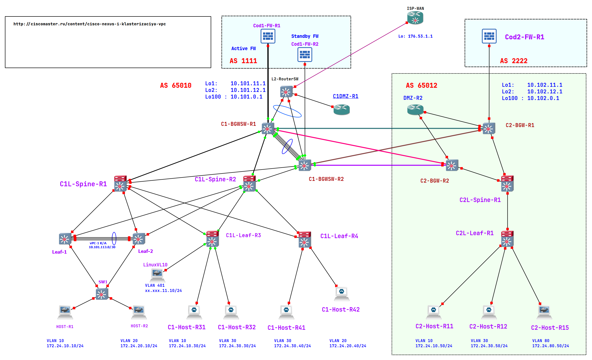

# Схема с vPC (на 04.03.2026)

Общая схема:



<details>
<summary>Настройки на C1-BGWSW-R1</summary>

```
C1-BGWSW-R1# sh run

!Command: show running-config
!Running configuration last done at: Wed Mar  4 02:28:08 2026
!Time: Wed Mar  4 13:55:40 2026

version 10.4(3) Bios:version
hostname C1-BGWSW-R1
vdc C1-BGWSW-R1 id 1
  limit-resource vlan minimum 16 maximum 4094
  limit-resource vrf minimum 2 maximum 4096
  limit-resource port-channel minimum 0 maximum 511
  limit-resource m4route-mem minimum 58 maximum 58
  limit-resource m6route-mem minimum 8 maximum 8

cfs eth distribute
nv overlay evpn
feature bgp
feature isis
feature fabric forwarding
feature interface-vlan
feature vn-segment-vlan-based
feature hsrp
feature lacp
feature vpc
clock timezone PRM 5 0
feature nv overlay
evpn multisite border-gateway 10
  delay-restore time 300

no password strength-check
username admin password 5 $5$JFOGII$tKGF10rDHfkijNedYnzZOGKwZVtMOqF0n.KcAw6y1S5  role network-admin
no ip domain-lookup
copp profile strict
hardware access-list tcam region racl 256
hardware access-list tcam region arp-ether 256 double-wide
snmp-server user admin network-admin auth md5 007581753622B7CE78CB6775C3A38972F78E priv aes-128 057EBC500A2BF4FA5ACC1D3B90F9D31DCCF6 localizedV2key
rmon event 1 log trap public description FATAL(1) owner PMON@FATAL
rmon event 2 log trap public description CRITICAL(2) owner PMON@CRITICAL
rmon event 3 log trap public description ERROR(3) owner PMON@ERROR
rmon event 4 log trap public description WARNING(4) owner PMON@WARNING
rmon event 5 log trap public description INFORMATION(5) owner PMON@INFO

fabric forwarding anycast-gateway-mac 0001.0001.0001
evpn storm-control broadcast level 10
evpn storm-control multicast level 10
evpn storm-control unicast level 10
vlan 1,10,20,30,50,60,80,100,400-401,1010,1030,1050,1060,1080,1310,1330,1350,1380,1400
vlan 10
  vn-segment 10000010
vlan 20
  vn-segment 10000020
vlan 30
  vn-segment 10000030
vlan 50
  vn-segment 10000050
vlan 60
  vn-segment 10000060
vlan 80
  vn-segment 10000080
vlan 400
  name CODLAN
vlan 401
  name DMZ
  vn-segment 10000401
vlan 1010
  vn-segment 51010
vlan 1030
  vn-segment 51030
vlan 1050
  vn-segment 51050
vlan 1060
  vn-segment 51060
vlan 1080
  vn-segment 51080
vlan 1310
  name VL10TOROUTER
vlan 1330
  name VL30TOROUTER
vlan 1350
  name VL50TOROUTER
vlan 1380
  name VL80TOROUTER
vlan 1400
  vn-segment 51400

spanning-tree vlan 1-3967 priority 16384
ip prefix-list PL_DENY_EXPORT seq 5 permit 0.0.0.0/0
ip prefix-list bgp_only_host seq 10 permit 0.0.0.0/0 eq 32
ip prefix-list bgp_only_net seq 5 deny 0.0.0.0/0
ip prefix-list bgp_only_net seq 10 deny 0.0.0.0/0 eq 32
ip prefix-list bgp_only_net seq 20 permit 0.0.0.0/0 le 31
ip prefix-list default_route seq 5 permit 0.0.0.0/0
ip prefix-list only_32_prefix description Allow only client host ip as /32 prefix
ip prefix-list only_32_prefix seq 10 permit 0.0.0.0/0 eq 32
ip prefix-list outbound-no-host description Allow only CIDR prefix send to router
ip prefix-list outbound-no-host seq 10 deny 0.0.0.0/0 eq 32
ip prefix-list outbound-no-host seq 20 permit 0.0.0.0/0 le 31
ip as-path access-list BGP_ONLY_INTERNAL seq 1 permit "^$"
ip as-path access-list bgp_trans_in seq 10 permit "_1111$"
ip as-path access-list bgp_trans_out seq 10 permit "_2222$"
ip as-path access-list only_extenal_as seq 10 permit "_2222$"
ip extcommunity-list standard ISP_CL seq 5 permit rt 65010:51400
route-map BGP_EXT_PREF permit 10
  set local-preference 50
route-map BGP_LOCAL_PREF permit 10
  set local-preference 100
route-map BGP_WAN_TO_LAN permit 10
  match extcommunity ISP1_CL
route-map RM-BGP-DIRECT permit 10
route-map RMAP_REDIST_DIRECT permit 10
  match tag 100101
route-map RM_DENY_IMPORT deny 10
  match ip address prefix-list PL_DENY_EXPORT
route-map RM_DENY_IMPORT permit 20
route-map bgp_static_default permit 10
  match tag 201
route-map bgp_trans_pref permit 10
  set local-preference 50
route-map only_32_prefix_external permit 10
  match as-path only_extenal_as
  match ip address prefix-list only_32_prefix
route-map only_32_prefix_external deny 20
  match as-path only_extenal_as
route-map only_32_prefix_external permit 50
route-map only_32_prefix_to_transit permit 10
  match ip address prefix-list only_32_prefix
  match evpn route-type 5
route-map only_ext32_prefix_from_transit permit 10
  match ip address prefix-list only_32_prefix
  match evpn route-type 5
key chain ISIS
  key 1
    key-string 7 070c285f4d064b0916100a
    cryptographic-algorithm MD5
vrf context DEMO
  vni 51030
  ip route 0.0.0.0/0 192.168.31.202 vrf LAN name DefToWan
  rd auto
  address-family ipv4 unicast
    route-target both auto
    route-target both auto evpn
    route-target import 65010:51050
    route-target import 65010:51050 evpn
    route-target import 65010:51400
    route-target import 65010:51400 evpn
    import map RM_DENY_IMPORT
vrf context LABA
  vni 51010
  ip route 0.0.0.0/0 192.168.31.202 vrf LAN name DefToWan
  rd auto
  address-family ipv4 unicast
    route-target both auto
    route-target both auto evpn
    route-target import 65010:51050
    route-target import 65010:51050 evpn
    route-target import 65010:51400
    route-target import 65010:51400 evpn
    import map RM_DENY_IMPORT
vrf context LAN
  vni 51400
  ip route 0.0.0.0/0 192.168.31.202 name DefToWan tag 201 10
  rd auto
  address-family ipv4 unicast
    route-target both auto
    route-target both auto evpn
    route-target import 65010:51010
    route-target import 65010:51010 evpn
    route-target import 65010:51030
    route-target import 65010:51030 evpn
    export map BGP_WAN_TO_LAN
vrf context PROD
  vni 51080
  ip route 0.0.0.0/0 192.168.31.202 vrf LAN name DefToWan
  rd auto
  address-family ipv4 unicast
    route-target both auto
    route-target both auto evpn
    route-target import 65010:51050
    route-target import 65010:51050 evpn
    export map BGP_WAN_TO_LAN
vrf context TRANSIT
  vni 51050
  rd auto
  address-family ipv4 unicast
    route-target both auto
    route-target both auto evpn
    route-target import 65010:51010
    route-target import 65010:51010 evpn
    route-target import 65010:51030
    route-target import 65010:51030 evpn
    route-target import 65010:51080
    route-target import 65010:51080 evpn
    export map only_ext32_prefix_from_transit
    import map only_32_prefix_to_transit
vrf context VRF_VPC_KEEPALIVE
  address-family ipv4 unicast
vrf context management
port-channel load-balance src-dst ip-l4port-vlan
vpc domain 11
  peer-switch
  role priority 1000
  peer-keepalive destination 10.101.13.2 source 10.101.13.1 vrf VRF_VPC_KEEPALIVE
  peer-gateway
  layer3 peer-router
  auto-recovery reload-delay 120


interface Vlan1
  no ip redirects
  no ipv6 redirects

interface Vlan400
  description HSRP LAN_to_WAN
  no shutdown
  mtu 9216
  vrf member LAN
  no ip redirects
  ip address 192.168.31.209/29
  hsrp version 2
  hsrp 400
    preempt delay reload 60
    priority 150
    ip 192.168.31.201/30

interface Vlan1010
  description L3VNI for vrf LABA
  no shutdown
  mtu 9216
  vrf member LABA
  no ip redirects
  ip forward
  ipv6 forward
  no ipv6 redirects

interface Vlan1030
  description L3VNI for vrf DEMO
  no shutdown
  mtu 9216
  vrf member DEMO
  no ip redirects
  ip forward
  ipv6 forward
  no ipv6 redirects

interface Vlan1050
  description L3VNI for vrf TRANSIT
  no shutdown
  mtu 9216
  vrf member TRANSIT
  no ip redirects
  ip forward
  ipv6 forward
  no ipv6 redirects

interface Vlan1400
  description L3VNI for vrf LAN
  no shutdown
  mtu 9216
  vrf member LAN
  no ip redirects
  ip forward
  ipv6 forward
  no ipv6 redirects

interface port-channel10
  description *** vPC Member Ports ***
  switchport mode trunk
  switchport trunk allowed vlan 400-401
  mtu 9216
  speed 1000
  duplex full
  vpc 10

interface port-channel100
  description *** VPC PEER LINKS ***
  switchport mode trunk
  spanning-tree port type network
  vpc peer-link

interface nve1
  no shutdown
  host-reachability protocol bgp
  advertise virtual-rmac
  source-interface loopback2
  global suppress-arp
  global ingress-replication protocol bgp
  multisite border-gateway interface loopback100
  member vni 51010 associate-vrf
  member vni 51030 associate-vrf
  member vni 51050 associate-vrf
  member vni 51080 associate-vrf
  member vni 51400 associate-vrf
  member vni 10000010
    multisite ingress-replication
  member vni 10000020
    multisite ingress-replication
  member vni 10000030
    multisite ingress-replication
  member vni 10000080
    multisite ingress-replication
  member vni 10000401
    multisite ingress-replication

interface Ethernet1/1
  description ** Fabric Internal to_Spine-R1 **
  no switchport
  mtu 9216
  speed 1000
  duplex full
  port-type fabric
  no ip redirects
  ip address 10.101.14.2/30
  ipv6 address use-link-local-only
  no ipv6 redirects
  isis network point-to-point
  ip router isis UNDERLAY
  no isis passive-interface level-1-2
  no shutdown
  evpn multisite fabric-tracking

interface Ethernet1/2
  description ** Fabric Internal to_Spine-R2 **
  no switchport
  mtu 9216
  speed 1000
  duplex full
  port-type fabric
  no ip redirects
  ip address 10.101.24.2/30
  ipv6 address use-link-local-only
  no ipv6 redirects
  isis network point-to-point
  ip router isis UNDERLAY
  no isis passive-interface level-1-2
  no shutdown
  evpn multisite fabric-tracking

interface Ethernet1/3
  shutdown
  mtu 9216
  speed 1000
  duplex full

interface Ethernet1/4
  description ** DCI to C2-R1 **
  no switchport
  mtu 9216
  speed 1000
  duplex full
  no ip redirects
  ip address 50.0.0.1/29 tag 100101
  ipv6 address use-link-local-only
  no ipv6 redirects
  isis shutdown
  no shutdown
  evpn multisite dci-tracking

interface Ethernet1/5
  description ** DCI to C2-R2 **
  no switchport
  mtu 9216
  speed 1000
  duplex full
  no ip redirects
  ip address 50.0.1.1/29 tag 100101
  ipv6 address use-link-local-only
  no ipv6 redirects
  isis shutdown
  no shutdown
  evpn multisite dci-tracking

interface Ethernet1/6
  shutdown

interface Ethernet1/7
  shutdown

interface Ethernet1/8
  description Trunk to FW
  no switchport
  mtu 9216
  speed 1000
  duplex full
  no shutdown

interface Ethernet1/8.10
  description VRF LABA to_FW
  mtu 9216
  encapsulation dot1q 1310
  vrf member LABA
  no ip redirects
  ip address 172.24.1.1/30
  no ipv6 redirects
  no shutdown

interface Ethernet1/8.30
  description VRF DEMO to_WF
  mtu 9216
  encapsulation dot1q 1330
  vrf member DEMO
  no ip redirects
  ip address 172.24.1.5/30
  no ipv6 redirects
  no shutdown

interface Ethernet1/8.50
  description VRF TRANSIT to_WF (OFF)
  mtu 9216
  encapsulation dot1q 1350
  vrf member TRANSIT
  ip address 172.24.1.49/30

interface Ethernet1/9
  shutdown

interface Ethernet1/10
  description *** vPC Member Ports ***
  switchport mode trunk
  switchport trunk allowed vlan 400-401
  mtu 9216
  speed 1000
  duplex full
  channel-group 10 mode active

interface Ethernet1/11
  shutdown

interface Ethernet1/12
  description Non-vPC trunk
  shutdown
  switchport mode trunk
  switchport trunk allowed vlan 400

interface Ethernet1/13
  description *** VPC PEER LINKS ***
  switchport mode trunk
  channel-group 100 mode active

interface Ethernet1/14
  description *** VPC PEER LINKS ***
  switchport mode trunk
  channel-group 100 mode active

interface Ethernet1/15
  description ** Keep-Alive vPC **
  no switchport
  speed 1000
  duplex full
  vrf member VRF_VPC_KEEPALIVE
  ip address 10.101.13.1/30
  no shutdown

interface Ethernet1/16

interface Ethernet1/17

interface Ethernet1/18

interface Ethernet1/19

interface Ethernet1/20

interface Ethernet1/21

interface Ethernet1/22

interface Ethernet1/23

interface Ethernet1/24

interface Ethernet1/25

interface Ethernet1/26

interface Ethernet1/27

interface Ethernet1/28

interface Ethernet1/29

interface Ethernet1/30

interface Ethernet1/31

interface Ethernet1/32

interface Ethernet1/33

interface Ethernet1/34

interface Ethernet1/35

interface Ethernet1/36

interface Ethernet1/37

interface Ethernet1/38

interface Ethernet1/39

interface Ethernet1/40

interface Ethernet1/41

interface Ethernet1/42

interface Ethernet1/43

interface Ethernet1/44

interface Ethernet1/45

interface Ethernet1/46

interface Ethernet1/47

interface Ethernet1/48

interface Ethernet1/49

interface Ethernet1/50

interface Ethernet1/51

interface Ethernet1/52

interface Ethernet1/53

interface Ethernet1/54

interface Ethernet1/55

interface Ethernet1/56

interface Ethernet1/57

interface Ethernet1/58

interface Ethernet1/59

interface Ethernet1/60

interface Ethernet1/61

interface Ethernet1/62

interface Ethernet1/63

interface Ethernet1/64

interface mgmt0
  vrf member management

interface loopback1
  description # Router ID (CP IP or RID)
  ip address 10.101.11.1/32 tag 100101
  ip router isis UNDERLAY

interface loopback2
  description # VTEP-ID (PIP)
  ip address 10.101.12.1/32 tag 100101
  ip address 10.101.12.5/32 secondary tag 100101
  ip router isis UNDERLAY

interface loopback50
  description * VRF TRANSIT *
  vrf member TRANSIT
  ip address 10.101.8.9/32

interface loopback100
  description Multi-Site VIP
  ip address 10.101.0.1/32 tag 100101
  ip router isis UNDERLAY

interface loopback310
  description Infra-Nve vrf LABA
  vrf member LABA
  ip address 10.101.220.1/32

interface loopback320
  description Infra-Nve vrf DEMO
  vrf member DEMO
  ip address 10.101.240.1/32

interface loopback380
  description Infra-Nve vrf PROD
  vrf member PROD
  ip address 10.101.208.1/32
icam monitor scale

cli alias name snd sh nve interface nve1 detail
cli alias name wr copy run start
cli alias name c conf term
cli alias name sir show ip route
cli alias name srr sh run | sec router
cli alias name stcam show hardware access-list tcam region
cli alias name hi sh cli history unformatted
cli alias name mastervpc vpc role preempt
cli alias name lbgp sh bgp l2vpn evpn summ
cli alias name fnve sh forwarding nve L3 peers
cli alias name emac sh l2route evpn mac all
cli alias name nvc sh nve vni control-plane
line console
  exec-timeout 0
  terminal length 35
  terminal width  168
line vty
boot nxos bootflash:/nxos64-cs.10.4.3.F.bin
router isis UNDERLAY
  net 49.0001.0101.0101.1001.00
  set-overload-bit on-startup 20
  log-adjacency-changes
  authentication-type md5 level-1
  authentication-type md5 level-2
  authentication key-chain ISIS level-1
  authentication key-chain ISIS level-2
  address-family ipv4 unicast
    maximum-paths 4
    router-id loopback1
  passive-interface default level-1-2
router bgp 65010
  router-id 10.101.12.1
  log-neighbor-changes
  address-family ipv4 unicast
    redistribute direct route-map RMAP_REDIST_DIRECT
    maximum-paths 4
  address-family l2vpn evpn
    advertise-pip
  template peer Firewall
    remote-as 1111
    description Router as firewall
    timers 7 21
    address-family ipv4 unicast
      send-community
      send-community extended
      prefix-list bgp_only_net in
      filter-list BGP_ONLY_INTERNAL out
      advertisement-interval 1
    address-family l2vpn evpn
  template peer SPINES
    remote-as 65010
    update-source loopback2
    address-family l2vpn evpn
      send-community
      send-community extended
  neighbor 10.101.212.1
    inherit peer SPINES
    description Spine-1
  neighbor 10.101.222.1
    inherit peer SPINES
    description Spine-2
  neighbor 10.102.11.1
    remote-as 65012
    description COD2-VTEP-BL1
    update-source loopback1
    disable-connected-check
    peer-type fabric-external
    address-family l2vpn evpn
      send-community
      send-community extended
      rewrite-evpn-rt-asn
  neighbor 10.102.21.1
    remote-as 65012
    description COD2-VTEP-BL2
    update-source loopback1
    disable-connected-check
    peer-type fabric-external
    address-family l2vpn evpn
      send-community
      send-community extended
      rewrite-evpn-rt-asn
  neighbor 50.0.0.2
    remote-as 65012
    description COD2-BorderLeaf-1
    update-source Ethernet1/4
    timers 7 21
    address-family ipv4 unicast
  neighbor 50.0.1.2
    remote-as 65012
    description COD2-BorderLeaf-2
    update-source Ethernet1/5
    timers 7 21
    address-family ipv4 unicast
  vrf DEMO
    router-id 172.24.1.5
    address-family ipv4 unicast
      network 0.0.0.0/0
      network 10.101.240.1/32
      redistribute static route-map bgp_static_default
      maximum-paths 2
      maximum-paths ibgp 2
      default-information originate
    neighbor 172.24.1.6
      inherit peer Firewall
      description COD-1-FW VL30
      update-source Ethernet1/8.30
  vrf LABA
    router-id 10.101.220.1
    address-family ipv4 unicast
      network 0.0.0.0/0
      network 10.101.220.1/32
      redistribute static route-map bgp_static_default
      maximum-paths 2
      maximum-paths ibgp 2
      default-information originate
    neighbor 172.24.1.2
      inherit peer Firewall
      description COD-1-FW VL10
      update-source Ethernet1/8.10
  vrf LAN
    address-family ipv4 unicast
      redistribute static route-map bgp_static_default
      export-gateway-ip
      default-information originate
  vrf PROD
    address-family ipv4 unicast
      maximum-paths ibgp 4
  vrf TRANSIT
    router-id 172.24.1.49
    address-family ipv4 unicast
      redistribute direct route-map RM-BGP-DIRECT
    neighbor 172.24.1.50
      remote-as 1111
      description COD-1-FW (OFF)
      shutdown
      timers 7 21
      address-family ipv4 unicast
        send-community
        send-community extended
        prefix-list bgp_only_host in
        filter-list bgp_trans_in in


C1-BGWSW-R1#

```

</details>

<details>
<summary>Настройки на C1-BGWSW-R2</summary>

```
C1-BGWSW-R2# sh run

!Command: show running-config
!No configuration change since last restart
!Time: Wed Mar  4 14:19:35 2026

version 10.4(3) Bios:version
hostname C1-BGWSW-R2
vdc C1-BGWSW-R2 id 1
  limit-resource vlan minimum 16 maximum 4094
  limit-resource vrf minimum 2 maximum 4096
  limit-resource port-channel minimum 0 maximum 511
  limit-resource m4route-mem minimum 58 maximum 58
  limit-resource m6route-mem minimum 8 maximum 8

cfs eth distribute
nv overlay evpn
feature bgp
feature isis
feature fabric forwarding
feature interface-vlan
feature vn-segment-vlan-based
feature hsrp
feature lacp
feature vpc
clock timezone PRM 5 0
feature nv overlay
evpn multisite border-gateway 10
  delay-restore time 300

no password strength-check
username admin password 5 $5$LFFNLD$lJUHwAExBXwlPV29yMlzDcBL7KFAj01EBnNt3lsfJ86  role network-admin
no ip domain-lookup
copp profile strict
hardware access-list tcam region racl 256
hardware access-list tcam region arp-ether 256 double-wide
snmp-server user admin network-admin auth md5 366A5C6DE7E220A00E1E5870E9FDBEBED6F4 priv aes-128 52260C69DB9B2698267F177EBCABA9B1CBC2 localizedV2key
rmon event 1 log trap public description FATAL(1) owner PMON@FATAL
rmon event 2 log trap public description CRITICAL(2) owner PMON@CRITICAL
rmon event 3 log trap public description ERROR(3) owner PMON@ERROR
rmon event 4 log trap public description WARNING(4) owner PMON@WARNING
rmon event 5 log trap public description INFORMATION(5) owner PMON@INFO

fabric forwarding anycast-gateway-mac 0001.0001.0001
evpn storm-control broadcast level 10
evpn storm-control multicast level 10
evpn storm-control unicast level 10
vlan 1,10,20,30,50,60,80,100,400-401,1010,1030,1050,1060,1080,1310,1330,1350,1380,1400
vlan 10
  vn-segment 10000010
vlan 20
  vn-segment 10000020
vlan 30
  vn-segment 10000030
vlan 50
  vn-segment 10000050
vlan 60
  vn-segment 10000060
vlan 80
  vn-segment 10000080
vlan 400
  name CODLAN
vlan 401
  name DMZ
  vn-segment 10000401
vlan 1010
  vn-segment 51010
vlan 1030
  vn-segment 51030
vlan 1050
  vn-segment 51050
vlan 1060
  vn-segment 51060
vlan 1080
  vn-segment 51080
vlan 1310
  name VL10TOROUTER
vlan 1330
  name VL30TOROUTER
vlan 1350
  name VL50TOROUTER
vlan 1380
  name VL80TOROUTER
vlan 1400
  vn-segment 51400

spanning-tree vlan 1-3967 priority 16384
ip prefix-list PL_DENY_EXPORT seq 5 permit 0.0.0.0/0
ip prefix-list bgp_only_host seq 10 permit 0.0.0.0/0 eq 32
ip prefix-list bgp_only_net seq 5 deny 0.0.0.0/0
ip prefix-list bgp_only_net seq 10 deny 0.0.0.0/0 eq 32
ip prefix-list bgp_only_net seq 20 permit 0.0.0.0/0 le 31
ip prefix-list default_route seq 5 permit 0.0.0.0/0
ip prefix-list only_32_prefix description Allow only client host ip as /32 prefix
ip prefix-list only_32_prefix seq 10 permit 0.0.0.0/0 eq 32
ip prefix-list outbound-no-host description Allow only CIDR prefix send to router
ip prefix-list outbound-no-host seq 10 deny 0.0.0.0/0 eq 32
ip prefix-list outbound-no-host seq 20 permit 0.0.0.0/0 le 31
ip as-path access-list BGP_ONLY_INTERNAL seq 1 permit "^$"
ip as-path access-list bgp_trans_in seq 10 permit "_1111$"
ip as-path access-list bgp_trans_out seq 10 permit "_2222$"
ip as-path access-list only_extenal_as seq 10 permit "_2222$"
ip extcommunity-list standard ISP_CL seq 5 permit rt 65010:51400
route-map BGP_EXT_PREF permit 10
  set local-preference 50
route-map BGP_LOCAL_PREF permit 10
  set local-preference 100
route-map BGP_WAN_TO_LAN permit 10
  match extcommunity ISP1_CL
route-map RM-BGP-DIRECT permit 10
route-map RMAP_REDIST_DIRECT permit 10
  match tag 100102
route-map RM_DENY_IMPORT deny 10
  match ip address prefix-list PL_DENY_EXPORT
route-map RM_DENY_IMPORT permit 20
route-map bgp_static_default permit 10
  match tag 201
route-map bgp_trans_pref permit 10
  set local-preference 50
route-map only_32_prefix_external permit 10
  match as-path only_extenal_as
  match ip address prefix-list only_32_prefix
route-map only_32_prefix_external deny 20
  match as-path only_extenal_as
route-map only_32_prefix_external permit 50
route-map only_32_prefix_to_transit permit 10
  match ip address prefix-list only_32_prefix
  match evpn route-type 5
route-map only_ext32_prefix_from_transit permit 10
  match ip address prefix-list only_32_prefix
  match evpn route-type 5
key chain ISIS
  key 1
    key-string 7 070c285f4d064b0916100a
    cryptographic-algorithm MD5
vrf context DEMO
  vni 51030
  ip route 0.0.0.0/0 Null0
  rd auto
  address-family ipv4 unicast
    route-target both auto
    route-target both auto evpn
    route-target import 65010:51050
    route-target import 65010:51050 evpn
    route-target import 65010:51400
    route-target import 65010:51400 evpn
    import map RM_DENY_IMPORT
vrf context LABA
  vni 51010
  ip route 0.0.0.0/0 192.168.31.202 vrf LAN name DefToWan
  rd auto
  address-family ipv4 unicast
    route-target both auto
    route-target both auto evpn
    route-target import 65010:51050
    route-target import 65010:51050 evpn
    route-target import 65010:51400
    route-target import 65010:51400 evpn
    import map RM_DENY_IMPORT
vrf context LAN
  vni 51400
  ip route 0.0.0.0/0 192.168.31.202 name DefToWan tag 201 10
  rd auto
  address-family ipv4 unicast
    route-target both auto
    route-target both auto evpn
    route-target import 65010:51010
    route-target import 65010:51010 evpn
    route-target import 65010:51030
    route-target import 65010:51030 evpn
    export map BGP_WAN_TO_LAN
vrf context PROD
  vni 51080
  rd auto
  address-family ipv4 unicast
    route-target both auto
    route-target both auto evpn
    route-target import 65010:51050
    route-target import 65010:51050 evpn
vrf context TRANSIT
  vni 51050
  rd auto
  address-family ipv4 unicast
    route-target both auto
    route-target both auto evpn
    route-target import 65010:51010
    route-target import 65010:51010 evpn
    route-target import 65010:51030
    route-target import 65010:51030 evpn
    route-target import 65010:51080
    route-target import 65010:51080 evpn
    export map only_ext32_prefix_from_transit
    import map only_32_prefix_to_transit
vrf context VRF_VPC_KEEPALIVE
  address-family ipv4 unicast
vrf context management
port-channel load-balance src-dst ip-l4port-vlan
vpc domain 11
  peer-switch
  role priority 2000
  peer-keepalive destination 10.101.13.1 source 10.101.13.2 vrf VRF_VPC_KEEPALIVE
  peer-gateway
  layer3 peer-router
  auto-recovery reload-delay 120


interface Vlan1
  no ip redirects
  no ipv6 redirects

interface Vlan400
  description HSRP LAN_to_WAN
  no shutdown
  mtu 9216
  vrf member LAN
  no ip redirects
  ip address 192.168.31.210/29
  hsrp version 2
  hsrp 400
    preempt delay reload 60
    ip 192.168.31.201/30

interface Vlan1010
  description L3VNI for vrf LABA
  no shutdown
  mtu 9216
  vrf member LABA
  no ip redirects
  ip forward
  ipv6 forward
  no ipv6 redirects

interface Vlan1030
  description L3VNI for vrf DEMO
  no shutdown
  mtu 9216
  vrf member DEMO
  no ip redirects
  ip forward
  ipv6 forward
  no ipv6 redirects

interface Vlan1050
  description L3VNI for vrf TRANSIT
  no shutdown
  mtu 9216
  vrf member TRANSIT
  no ip redirects
  ip forward
  ipv6 forward
  no ipv6 redirects

interface Vlan1400
  description L3VNI for vrf LAN
  no shutdown
  mtu 9216
  vrf member LAN
  no ip redirects
  ip forward
  ipv6 forward
  no ipv6 redirects

interface port-channel10
  description *** vPC Member Ports ***
  switchport mode trunk
  switchport trunk allowed vlan 400-401
  mtu 9216
  speed 1000
  duplex full
  vpc 10

interface port-channel100
  description *** VPC PEER LINKS ***
  switchport mode trunk
  spanning-tree port type network
  vpc peer-link

interface nve1
  no shutdown
  host-reachability protocol bgp
  advertise virtual-rmac
  source-interface loopback2
  global suppress-arp
  global ingress-replication protocol bgp
  multisite border-gateway interface loopback100
  member vni 51010 associate-vrf
  member vni 51030 associate-vrf
  member vni 51050 associate-vrf
  member vni 51080 associate-vrf
  member vni 51400 associate-vrf
  member vni 10000010
    multisite ingress-replication
  member vni 10000020
    multisite ingress-replication
  member vni 10000030
    multisite ingress-replication
  member vni 10000080
    multisite ingress-replication
  member vni 10000401
    multisite ingress-replication

interface Ethernet1/1
  description ** Fabric Internal to_Spine-R1 **
  no switchport
  mtu 9216
  speed 1000
  duplex full
  port-type fabric
  ip address 10.101.14.6/30
  ipv6 address use-link-local-only
  isis network point-to-point
  ip router isis UNDERLAY
  no isis passive-interface level-1-2
  no shutdown
  evpn multisite fabric-tracking

interface Ethernet1/2
  description ** Fabric Internal to_Spine-R2 **
  no switchport
  mtu 9216
  speed 1000
  duplex full
  port-type fabric
  ip address 10.101.24.6/30
  ipv6 address use-link-local-only
  isis network point-to-point
  ip router isis UNDERLAY
  no isis passive-interface level-1-2
  no shutdown
  evpn multisite fabric-tracking

interface Ethernet1/3
  shutdown
  mtu 9216
  speed 1000
  duplex full

interface Ethernet1/4
  description ** DCI Iface to C2-R1 **
  no switchport
  mtu 9216
  speed 1000
  duplex full
  no ip redirects
  ip address 50.0.2.1/29 tag 100102
  ipv6 address use-link-local-only
  no ipv6 redirects
  isis shutdown
  no shutdown
  evpn multisite dci-tracking

interface Ethernet1/5
  description ** DCI Iface C2-R2 **
  no switchport
  mtu 9216
  speed 1000
  duplex full
  no ip redirects
  ip address 50.0.3.1/29 tag 100102
  ipv6 address use-link-local-only
  no ipv6 redirects
  isis shutdown
  no shutdown
  evpn multisite dci-tracking

interface Ethernet1/6
  shutdown

interface Ethernet1/7
  shutdown

interface Ethernet1/8
  description Trunk to FW
  no switchport
  mtu 9216
  speed 1000
  duplex full
  no shutdown

interface Ethernet1/8.10
  description VRF LABA to_BackupFW
  mtu 9216
  encapsulation dot1q 1310
  vrf member LABA
  no ip redirects
  ip address 172.24.2.1/30
  no ipv6 redirects
  no shutdown

interface Ethernet1/8.30
  description VRF DEMO to_WF
  mtu 9216
  encapsulation dot1q 1330
  vrf member DEMO
  ip address 172.24.2.5/30
  no ipv6 redirects
  no shutdown

interface Ethernet1/8.50
  description VRF TRANSIT to_WF (OFF)
  mtu 9216
  encapsulation dot1q 1350
  vrf member TRANSIT
  ip address 172.24.2.49/30
  no ipv6 redirects

interface Ethernet1/9
  shutdown

interface Ethernet1/10
  description *** vPC Member Ports ***
  switchport mode trunk
  switchport trunk allowed vlan 400-401
  mtu 9216
  speed 1000
  duplex full
  channel-group 10 mode active

interface Ethernet1/11
  shutdown

interface Ethernet1/12
  description Non-vPC trunk
  shutdown
  switchport mode trunk
  switchport trunk allowed vlan 400

interface Ethernet1/13
  description *** VPC PEER LINKS ***
  switchport mode trunk
  channel-group 100 mode active

interface Ethernet1/14
  description *** VPC PEER LINKS ***
  switchport mode trunk
  channel-group 100 mode active

interface Ethernet1/15
  description ** Keep-Alive vPC **
  no switchport
  speed 1000
  duplex full
  vrf member VRF_VPC_KEEPALIVE
  ip address 10.101.13.2/30
  no shutdown

interface Ethernet1/16

interface Ethernet1/17

interface Ethernet1/18

interface Ethernet1/19

interface Ethernet1/20

interface Ethernet1/21

interface Ethernet1/22

interface Ethernet1/23

interface Ethernet1/24

interface Ethernet1/25

interface Ethernet1/26

interface Ethernet1/27

interface Ethernet1/28

interface Ethernet1/29

interface Ethernet1/30

interface Ethernet1/31

interface Ethernet1/32

interface Ethernet1/33

interface Ethernet1/34

interface Ethernet1/35

interface Ethernet1/36

interface Ethernet1/37

interface Ethernet1/38

interface Ethernet1/39

interface Ethernet1/40

interface Ethernet1/41

interface Ethernet1/42

interface Ethernet1/43

interface Ethernet1/44

interface Ethernet1/45

interface Ethernet1/46

interface Ethernet1/47

interface Ethernet1/48

interface Ethernet1/49

interface Ethernet1/50

interface Ethernet1/51

interface Ethernet1/52

interface Ethernet1/53

interface Ethernet1/54

interface Ethernet1/55

interface Ethernet1/56

interface Ethernet1/57

interface Ethernet1/58

interface Ethernet1/59

interface Ethernet1/60

interface Ethernet1/61

interface Ethernet1/62

interface Ethernet1/63

interface Ethernet1/64

interface mgmt0
  vrf member management

interface loopback1
  description # Router ID (CP IP or RID)
  ip address 10.101.21.1/32 tag 100102
  ip router isis UNDERLAY

interface loopback2
  description # VTEP-ID (PIP)
  ip address 10.101.22.1/32 tag 100102
  ip address 10.101.12.5/32 secondary tag 100102
  ip router isis UNDERLAY

interface loopback50
  description * VRF TRANSIT *
  vrf member TRANSIT
  ip address 10.101.8.10/32

interface loopback100
  description Multi-Site VIP
  ip address 10.101.0.1/32 tag 100102
  ip router isis UNDERLAY

interface loopback310
  description Infra-Nve vrf LABA
  vrf member LABA
  ip address 10.101.220.2/32

interface loopback320
  description Infra-Nve vrf DEMO
  vrf member DEMO
  ip address 10.101.240.2/32

interface loopback380
  description Infra-Nve vrf PROD
  vrf member PROD
  ip address 10.101.208.2/32
icam monitor scale

cli alias name snd sh nve interface nve1 detail
cli alias name wr copy run start
cli alias name c conf term
cli alias name sir show ip route
cli alias name srr sh run | sec router
cli alias name stcam show hardware access-list tcam region
cli alias name hi sh cli history unformatted
cli alias name mastervpc vpc role preempt
cli alias name lbgp sh bgp l2vpn evpn summ
cli alias name fnve sh forwarding nve L3 peers
cli alias name emac sh l2route evpn mac all
cli alias name nvc sh nve vni control-plane
line console
  exec-timeout 0
  terminal length 35
  terminal width  168
line vty
boot nxos bootflash:/nxos64-cs.10.4.3.F.bin
router isis UNDERLAY
  net 49.0001.0101.0102.1001.00
  set-overload-bit on-startup 20
  log-adjacency-changes
  authentication-type md5 level-1
  authentication-type md5 level-2
  authentication key-chain ISIS level-1
  authentication key-chain ISIS level-2
  address-family ipv4 unicast
    maximum-paths 4
    router-id loopback1
  passive-interface default level-1-2
router bgp 65010
  router-id 10.101.22.1
  address-family ipv4 unicast
    redistribute direct route-map RMAP_REDIST_DIRECT
    maximum-paths 4
  address-family l2vpn evpn
    advertise-pip
  template peer Firewall
    remote-as 1111
    description Router as firewall
    timers 7 21
    address-family ipv4 unicast
      send-community
      send-community extended
      prefix-list bgp_only_net in
      filter-list BGP_ONLY_INTERNAL out
      advertisement-interval 1
    address-family l2vpn evpn
  template peer SPINES
    remote-as 65010
    update-source loopback2
    address-family l2vpn evpn
      send-community
      send-community extended
  neighbor 10.101.212.1
    inherit peer SPINES
    description Spine-1
  neighbor 10.101.222.1
    inherit peer SPINES
    description Spine-2
  neighbor 10.102.11.1
    remote-as 65012
    description COD2-VTEP-BL1
    update-source loopback1
    disable-connected-check
    peer-type fabric-external
    address-family l2vpn evpn
      send-community
      send-community extended
      rewrite-evpn-rt-asn
  neighbor 10.102.21.1
    remote-as 65012
    description COD2-VTEP-BL2
    update-source loopback1
    disable-connected-check
    peer-type fabric-external
    address-family l2vpn evpn
      send-community
      send-community extended
      rewrite-evpn-rt-asn
  neighbor 50.0.2.2
    remote-as 65012
    description COD2-BorderLeaf-1
    update-source Ethernet1/4
    timers 7 21
    address-family ipv4 unicast
  neighbor 50.0.3.2
    remote-as 65012
    description COD2-BorderLeaf-2
    update-source Ethernet1/5
    timers 7 21
    address-family ipv4 unicast
  vrf DEMO
    router-id 172.24.1.13
    address-family ipv4 unicast
      network 0.0.0.0/0
      network 10.101.240.2/32
      redistribute static route-map bgp_static_default
      maximum-paths 2
      maximum-paths ibgp 2
      default-information originate
    neighbor 172.24.2.6
      inherit peer Firewall
      description To_WF2
      update-source Ethernet1/8.30
  vrf LABA
    router-id 10.101.220.2
    address-family ipv4 unicast
      network 0.0.0.0/0
      redistribute static route-map bgp_static_default
      maximum-paths 2
      maximum-paths ibgp 2
      default-information originate
    neighbor 172.24.2.2
      inherit peer Firewall
      description To_WF2 VL10
      update-source Ethernet1/8.10
  vrf LAN
    address-family ipv4 unicast
      redistribute static route-map bgp_static_default
      export-gateway-ip
      default-information originate
  vrf PROD
    address-family ipv4 unicast
      maximum-paths ibgp 4
  vrf TRANSIT
    router-id 172.24.1.49
    address-family ipv4 unicast
      redistribute direct route-map RM-BGP-DIRECT


C1-BGWSW-R2#
```

</details>

<details>
<summary>Настройки на C1-Spine-R2</summary>

```
C1-Spine-R2# sh run

!Command: show running-config
!No configuration change since last restart
!Time: Wed Mar  4 15:16:24 2026

version 10.3(5) Bios:version
hostname C1-Spine-R2
vdc C1-Spine-R2 id 1
  limit-resource vlan minimum 16 maximum 4094
  limit-resource vrf minimum 2 maximum 4096
  limit-resource port-channel minimum 0 maximum 511
  limit-resource m4route-mem minimum 58 maximum 58
  limit-resource m6route-mem minimum 8 maximum 8

nv overlay evpn
feature bgp
feature isis
clock timezone PRM 5 0

no password strength-check
username admin password 5 $5$ODLCGD$X3TS8OR/PYDHGE52WQizd.qit4qWSmezvWSHdaeK5j5  role network-admin
ip domain-lookup
copp profile strict
snmp-server user admin network-admin auth md5 330C4EAE90347E255DAC2E107D307EEE2071 priv aes-128 330842AC846A2D7A45AC256A3A7878D66928 localizedV2key
rmon event 1 log trap public description FATAL(1) owner PMON@FATAL
rmon event 2 log trap public description CRITICAL(2) owner PMON@CRITICAL
rmon event 3 log trap public description ERROR(3) owner PMON@ERROR
rmon event 4 log trap public description WARNING(4) owner PMON@WARNING
rmon event 5 log trap public description INFORMATION(5) owner PMON@INFO

vlan 1

key chain ISIS
  key 1
    key-string 7 070c285f4d064b0916100a
vrf context management


interface Ethernet1/1
  description to_leaf_1
  no switchport
  mtu 9216
  speed 1000
  duplex full
  ip address 10.101.224.1/30
  ipv6 address use-link-local-only
  isis metric 100 level-1
  isis metric 100 level-2
  isis network point-to-point
  ip router isis UNDERLAY
  no isis passive-interface level-1-2
  no shutdown

interface Ethernet1/2
  description to_leaf_2
  no switchport
  mtu 9216
  speed 1000
  duplex full
  ip address 10.101.224.5/30
  ipv6 address use-link-local-only
  isis metric 100 level-1
  isis metric 100 level-2
  isis network point-to-point
  ip router isis UNDERLAY
  no isis passive-interface level-1-2
  no shutdown

interface Ethernet1/3
  description to_leaf_3
  no switchport
  mtu 9216
  speed 1000
  duplex full
  ip address 10.101.224.9/30
  ipv6 address use-link-local-only
  isis metric 100 level-1
  isis metric 100 level-2
  isis network point-to-point
  ip router isis UNDERLAY
  no isis passive-interface level-1-2
  no shutdown

interface Ethernet1/4
  description to_leaf_4
  no switchport
  mtu 9216
  speed 1000
  duplex full
  ip address 10.101.224.13/30
  ipv6 address use-link-local-only
  isis metric 100 level-1
  isis metric 100 level-2
  isis network point-to-point
  ip router isis UNDERLAY
  no isis passive-interface level-1-2
  no shutdown

interface Ethernet1/5
  shutdown

interface Ethernet1/6
  description to_brdleaf-1
  no switchport
  mtu 9216
  speed 1000
  duplex full
  ip address 10.101.24.1/30
  isis network point-to-point
  ip router isis UNDERLAY
  no isis passive-interface level-1-2
  no shutdown

interface Ethernet1/7
  description to_brdleaf-2
  no switchport
  mtu 9216
  speed 1000
  duplex full
  ip address 10.101.24.5/30
  isis network point-to-point
  ip router isis UNDERLAY
  no isis passive-interface level-1-2
  no shutdown

interface Ethernet1/8
  shutdown

interface Ethernet1/9
  shutdown

interface Ethernet1/10

interface Ethernet1/11

interface Ethernet1/12

interface Ethernet1/13

interface Ethernet1/14

interface Ethernet1/15

interface Ethernet1/16

interface Ethernet1/17

interface Ethernet1/18

interface Ethernet1/19

interface Ethernet1/20

interface Ethernet1/21

interface Ethernet1/22

interface Ethernet1/23

interface Ethernet1/24

interface Ethernet1/25

interface Ethernet1/26

interface Ethernet1/27

interface Ethernet1/28

interface Ethernet1/29

interface Ethernet1/30

interface Ethernet1/31

interface Ethernet1/32

interface Ethernet1/33

interface Ethernet1/34

interface Ethernet1/35

interface Ethernet1/36

interface Ethernet1/37

interface Ethernet1/38

interface Ethernet1/39

interface Ethernet1/40

interface Ethernet1/41

interface Ethernet1/42

interface Ethernet1/43

interface Ethernet1/44

interface Ethernet1/45

interface Ethernet1/46

interface Ethernet1/47

interface Ethernet1/48

interface Ethernet1/49

interface Ethernet1/50

interface Ethernet1/51

interface Ethernet1/52

interface Ethernet1/53

interface Ethernet1/54

interface Ethernet1/55

interface Ethernet1/56

interface Ethernet1/57

interface Ethernet1/58

interface Ethernet1/59

interface Ethernet1/60

interface Ethernet1/61

interface Ethernet1/62

interface Ethernet1/63

interface Ethernet1/64

interface mgmt0
  vrf member management

interface loopback1
  description # Router ID
  ip address 10.101.221.1/32
  ip router isis UNDERLAY

interface loopback2
  description # VTEP-ID
  ip address 10.101.222.1/32
  ip router isis UNDERLAY
cli alias name wr copy run start
cli alias name c conf term
cli alias name sir show ip route
cli alias name cef show forwarding ipv4
cli alias name adj show ip adj
cli alias name hash show routing hash
cli alias name fadj show forwarding adjacency
cli alias name srr sh run | sec router
line console
  exec-timeout 0
  terminal length 40
  terminal width  168
line vty
boot nxos bootflash:/nxos64-cs-lite.10.3.5.M.bin
router isis UNDERLAY
  net 49.0001.0101.0122.1001.00
  is-type level-1
  set-overload-bit on-startup 20
  log-adjacency-changes
  authentication-type md5 level-1
  authentication-type md5 level-2
  authentication key-chain ISIS level-1
  authentication key-chain ISIS level-2
  address-family ipv4 unicast
    maximum-paths 2
    router-id loopback1
  passive-interface default level-1-2
router bgp 65010
  router-id 10.101.222.1
  template peer LEAFS
    remote-as 65010
    update-source loopback2
    address-family ipv4 unicast
      advertisement-interval 1
    address-family l2vpn evpn
      send-community
      send-community extended
      route-reflector-client
  neighbor 10.101.12.1
    inherit peer LEAFS
    description BRF-Leaf-R1
  neighbor 10.101.22.1
    inherit peer LEAFS
    description BRF-Leaf-R2
  neighbor 10.101.112.1
    inherit peer LEAFS
    description Leaf-1
  neighbor 10.101.122.1
    inherit peer LEAFS
    description Leaf-2
  neighbor 10.101.132.1
    inherit peer LEAFS
    description Leaf-3
  neighbor 10.101.142.1
    inherit peer LEAFS
    description Leaf-4


C1-Spine-R2#
```

</details>

<details>
<summary>Настройки на C1L-Leaf-R3</summary>

```
C1L-Leaf-R3# sh run

!Command: show running-config
!No configuration change since last restart
!Time: Wed Mar  4 15:19:39 2026

version 10.3(5) Bios:version
hostname C1L-Leaf-R3
vdc C1L-Leaf-R3 id 1
  limit-resource vlan minimum 16 maximum 4094
  limit-resource vrf minimum 2 maximum 4096
  limit-resource port-channel minimum 0 maximum 511
  limit-resource m4route-mem minimum 58 maximum 58
  limit-resource m6route-mem minimum 8 maximum 8

feature telnet
nv overlay evpn
feature bgp
feature isis
feature fabric forwarding
feature interface-vlan
feature vn-segment-vlan-based
clock timezone PRM 5 0
feature nv overlay

no password strength-check
username admin password 5 $5$EFMBDN$We92FsWMOLXgHCUT2J9tnpoOkdiXSr11UN2Ud.LleZ6  role network-admin
no ip domain-lookup
copp profile strict
snmp-server user admin network-admin auth md5 0163014720D0186F318BE2D3266B8E0CE068 priv aes-128 056F514B58B25A016FF897EF3077803BC53C localizedV2key
rmon event 1 log trap public description FATAL(1) owner PMON@FATAL
rmon event 2 log trap public description CRITICAL(2) owner PMON@CRITICAL
rmon event 3 log trap public description ERROR(3) owner PMON@ERROR
rmon event 4 log trap public description WARNING(4) owner PMON@WARNING
rmon event 5 log trap public description INFORMATION(5) owner PMON@INFO

fabric forwarding anycast-gateway-mac 0001.0001.0001
vlan 1,10,30,50,401,1010,1030,1400
vlan 10
  vn-segment 10000010
vlan 30
  vn-segment 10000030
vlan 50
  vn-segment 10000050
vlan 401
  name DMZ
  vn-segment 10000401
vlan 1010
  vn-segment 51010
vlan 1030
  vn-segment 51030
vlan 1400
  name L3VNIforLAN

ip as-path access-list BGP_ONLY_INTERNAL seq 1 permit "^$"
route-map RM_PERMIT_IPv4 permit 10
key chain ISIS
  key 1
    key-string 7 070c285f4d064b0916100a
vrf context DEMO
  vni 51030
  rd auto
  address-family ipv4 unicast
    route-target both auto
    route-target both auto evpn
vrf context LABA
  vni 51010
  rd auto
  address-family ipv4 unicast
    route-target both auto
    route-target both auto evpn
vrf context management
hardware profile tcam resource template LEAF_TCAM_CARVE ref-template nfe
  racl 256
  e-racl 0
  arp-ether 256
hardware profile tcam resource service-template LEAF_TCAM_CARVE


interface Vlan1

interface Vlan10
  description # Member vrf LABA #
  no shutdown
  mtu 9216
  vrf member LABA
  no ip redirects
  ip address 172.24.10.1/24
  ipv6 address use-link-local-only
  no ipv6 redirects
  fabric forwarding mode anycast-gateway

interface Vlan30
  description # Member vrf DEMO #
  no shutdown
  mtu 9216
  vrf member DEMO
  no ip redirects
  ip address 172.24.30.1/24
  ipv6 address use-link-local-only
  no ipv6 redirects
  fabric forwarding mode anycast-gateway

interface Vlan1010
  description * L3VNI VRF LABA *
  no shutdown
  mtu 9216
  vrf member LABA
  no ip redirects
  ip forward
  ipv6 forward
  no ipv6 redirects

interface Vlan1030
  description * L3VNI VRF DEMO *
  no shutdown
  mtu 9216
  vrf member DEMO
  no ip redirects
  ip forward
  ipv6 forward
  no ipv6 redirects

interface nve1
  no shutdown
  host-reachability protocol bgp
  source-interface loopback2
  global suppress-arp
  global ingress-replication protocol bgp
  member vni 51010 associate-vrf
  member vni 51030 associate-vrf
  member vni 10000010
  member vni 10000030
  member vni 10000401

interface Ethernet1/1
  description to_spine_1
  no switchport
  mtu 9216
  speed 1000
  duplex full
  ip address 10.101.214.10/30
  ipv6 address use-link-local-only
  isis metric 100 level-1
  isis metric 100 level-2
  isis network point-to-point
  ip router isis UNDERLAY
  no isis passive-interface level-1-2
  no shutdown

interface Ethernet1/2
  description to_spine_2
  no switchport
  mtu 9216
  speed 1000
  duplex full
  ip address 10.101.224.10/30
  ipv6 address use-link-local-only
  isis metric 100 level-1
  isis metric 100 level-2
  isis network point-to-point
  ip router isis UNDERLAY
  no isis passive-interface level-1-2
  no shutdown

interface Ethernet1/3
  shutdown

interface Ethernet1/4
  description *** DMZ Linux ***
  switchport access vlan 401
  mtu 9216
  speed 1000
  duplex full

interface Ethernet1/5
  description *** to_HOST-R31 ***
  switchport access vlan 10
  mtu 9216
  speed 1000
  duplex full

interface Ethernet1/6
  description *** to_HOST-R31 ***
  switchport access vlan 30
  mtu 9216
  speed 1000
  duplex full

interface Ethernet1/7
  shutdown

interface Ethernet1/8
  shutdown

interface Ethernet1/9
  shutdown

interface Ethernet1/10

interface Ethernet1/11

interface Ethernet1/12

interface Ethernet1/13

interface Ethernet1/14

interface Ethernet1/15

interface Ethernet1/16

interface Ethernet1/17

interface Ethernet1/18

interface Ethernet1/19

interface Ethernet1/20

interface Ethernet1/21

interface Ethernet1/22

interface Ethernet1/23

interface Ethernet1/24

interface Ethernet1/25

interface Ethernet1/26

interface Ethernet1/27

interface Ethernet1/28

interface Ethernet1/29

interface Ethernet1/30

interface Ethernet1/31

interface Ethernet1/32

interface Ethernet1/33

interface Ethernet1/34

interface Ethernet1/35

interface Ethernet1/36

interface Ethernet1/37

interface Ethernet1/38

interface Ethernet1/39

interface Ethernet1/40

interface Ethernet1/41

interface Ethernet1/42

interface Ethernet1/43

interface Ethernet1/44

interface Ethernet1/45

interface Ethernet1/46

interface Ethernet1/47

interface Ethernet1/48

interface Ethernet1/49

interface Ethernet1/50

interface Ethernet1/51

interface Ethernet1/52

interface Ethernet1/53

interface Ethernet1/54

interface Ethernet1/55

interface Ethernet1/56

interface Ethernet1/57

interface Ethernet1/58

interface Ethernet1/59

interface Ethernet1/60

interface Ethernet1/61

interface Ethernet1/62

interface Ethernet1/63

interface Ethernet1/64

interface mgmt0
  vrf member management

interface loopback1
  description # Router-ID
  ip address 10.101.131.1/32
  ip router isis UNDERLAY

interface loopback2
  description # VTEP-ID
  ip address 10.101.132.1/32
  ip router isis UNDERLAY
cli alias name wr copy run start
cli alias name c conf term
cli alias name sir show ip route
cli alias name srr sh run | sec router
cli alias name hi sh cli history unformatted
cli alias name snd sh nve interface nve1 detail
cli alias name lbgp sh bgp l2vpn evpn summ
cli alias name fnve sh forwarding nve L3 peers
cli alias name emac sh l2route evpn mac all
cli alias name nvc sh nve vni control-plane
line console
  exec-timeout 0
  terminal length 40
  terminal width  168
line vty
boot nxos bootflash:/nxos64-cs-lite.10.3.5.M.bin
router isis UNDERLAY
  net 49.0001.0101.0113.1001.00
  log-adjacency-changes
  authentication-type md5 level-1
  authentication-type md5 level-2
  authentication key-chain ISIS level-1
  authentication key-chain ISIS level-2
  address-family ipv4 unicast
    maximum-paths 2
    router-id loopback1
  passive-interface default level-1-2
router bgp 65010
  router-id 10.101.132.1
  address-family l2vpn evpn
    maximum-paths mixed 8
  template peer SPINES
    remote-as 65010
    update-source loopback2
    address-family ipv4 unicast
      advertisement-interval 1
    address-family l2vpn evpn
      send-community
      send-community extended
      filter-list BGP_ONLY_INTERNAL out
  neighbor 10.101.212.1
    inherit peer SPINES
    description Spine-1
  neighbor 10.101.222.1
    inherit peer SPINES
    description Spine-2
  vrf DEMO
    address-family ipv4 unicast
      redistribute hmm route-map RM_PERMIT_IPv4
      redistribute direct route-map RM_PERMIT_IPv4
      maximum-paths ibgp 4
  vrf LABA
    address-family ipv4 unicast
      redistribute hmm route-map RM_PERMIT_IPv4
      redistribute direct route-map RM_PERMIT_IPv4
      maximum-paths ibgp 4


C1L-Leaf-R3#
```

</details>


